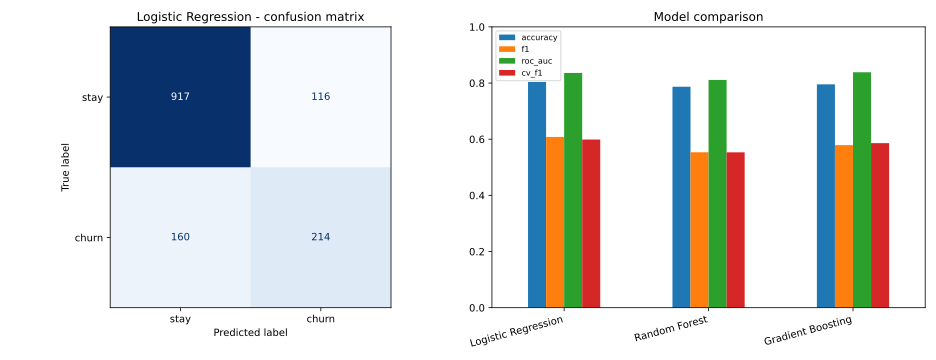

# Telco Customer Churn Prediction

Practice project built with AI assistance on a public dataset. It predicts whether a
telecom customer will churn (leave) from their account and billing
attributes, and includes a Streamlit web app for interactive predictions.

## Dataset

IBM Telco Customer Churn dataset (7043 customers, widely used public
teaching dataset). Downloaded automatically on first run if missing (and included in the offline copy). Cleaning: 11 rows with empty
`TotalCharges` are dropped; churn rate is 26.5%.

## Project structure

- `train.py` - full pipeline: cleaning, one-hot encoding + scaling in a
  sklearn Pipeline, model comparison, evaluation, plots.
- `app.py` - Streamlit app: describe a customer in the sidebar, get a
  churn probability.
- `results.svg` - confusion matrix and model comparison charts.
- `telco.csv` - the dataset.

## How to run

```bash
pip install -r requirements.txt
python train.py        # model comparison + plots
streamlit run app.py   # web app on http://localhost:8501
```

## Results (test split = 20%, random_state=42)

| Model               | Accuracy | F1 (churn) | ROC AUC | 5-fold CV F1 |
|---------------------|----------|------------|---------|--------------|
| Logistic Regression | 0.804    | 0.608      | 0.836   | 0.599        |
| Gradient Boosting   | 0.795    | 0.579      | 0.838   | 0.586        |
| Random Forest       | 0.787    | 0.554      | 0.811   | 0.553        |



## Honest notes

- Practice project on a public sample dataset, not a real business tool.
- Churn F1 around 0.6 is typical for this dataset without heavier feature
  engineering; accuracy alone is misleading because 73.5% of customers
  stay.
